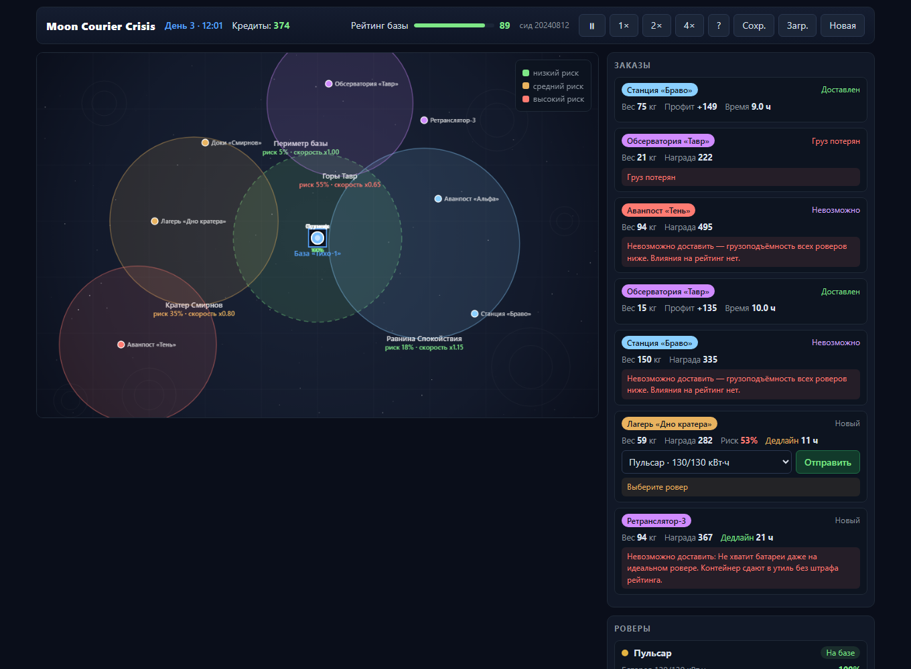
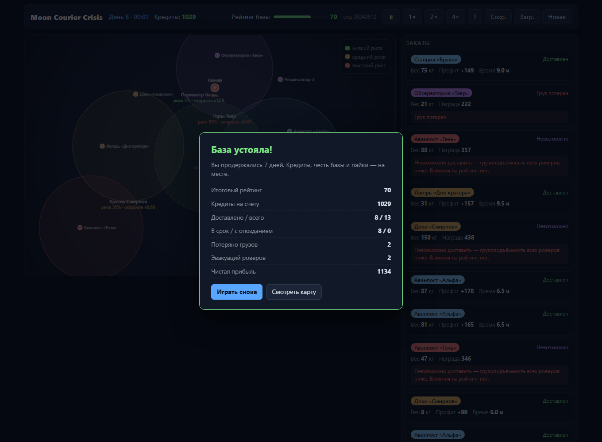
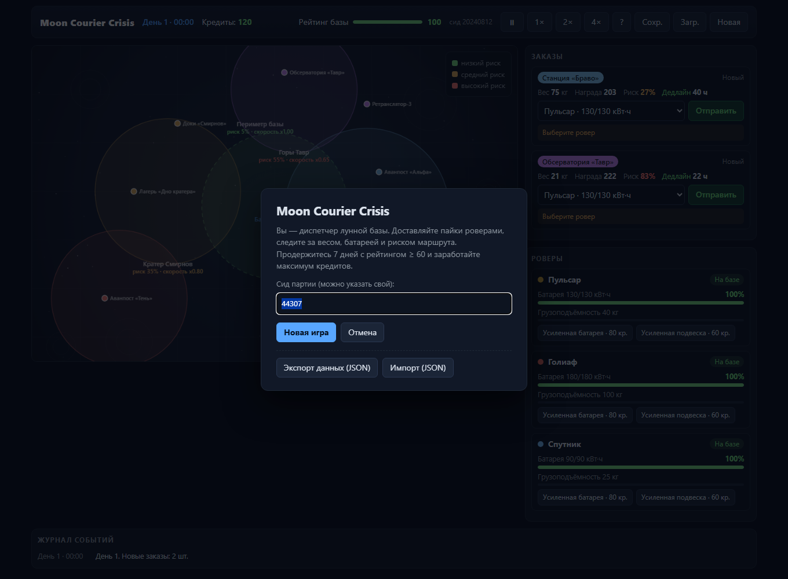
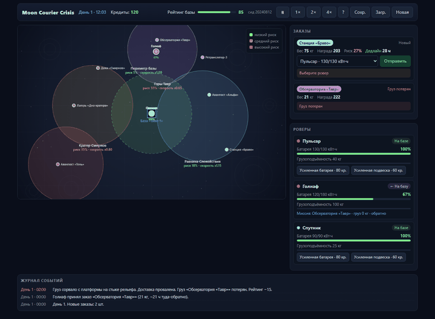

<div align="center">

# Moon Courier Crisis

Игровой симулятор лунной доставки. Вы — диспетчер базы «Тихо-1» на Луне.

[](https://developer.mozilla.org/)
[](https://developer.mozilla.org/en-US/docs/Web/API/Canvas_API)
[](https://nodejs.org/)
[](https://nodejs.org/)

**66 юнит-тестов · 29 тестов REST API · сервер-авторитативная симуляция · чистый JS без зависимостей**

</div>

---

Игровой симулятор лунной доставки. Вы — диспетчер базы «Тихо-1» на Луне.
На карте разбросаны аванпосты, на базу приходят заказы на доставку пайков,
а в гараже стоят роверы с ограниченными батареей и грузоподъёмностью.

Задача — 7 игровых дней продержать рейтинг базы **не ниже 60** и заработать
максимум кредитов, разумно назначая заказы и не теряя роверы в красных зонах.

**Стек:** чистый JavaScript + HTML5 Canvas, без фреймворков и внешних зависимостей.
Дополнительно есть REST API-бэкенд на Node (только встроенные модули, без npm).
Работает в любом современном браузере.



## Как запустить

**Просто игра (офлайн):** откройте `index.html` в браузере (двойной клик по файлу).
Интернет не нужен — игра целиком состоит из локальных файлов.

**С API-бэкендом:** поднимите сервер и откройте http://localhost:8080 — клиент
автоматически переключится в режим «server-authoritative» (состояние и решения
хранятся на сервере, клиент — тонкий слой отображения):

```bash
node server.js        # сервер: REST API + раздача статики, порт 8080
```

Для локального статического сервера (если нужен только фронтенд):

```bash
# Python
python -m http.server 8000   # затем http://localhost:8000

# Node
npx serve .                  # затем http://localhost:8000
```

Хранилище — `localStorage` браузера (офлайн) или файл `data/save.json` на сервере.
В офлайн-режиме сохранение пишется автоматически каждые ~3 секунды.
Кнопки **Сохр./Загр.** в шапке — ручное сохранение и загрузка из хранилища.
**Экспорт/Импорт (JSON)** в меню «Новая» — выгрузка сохранения в файл и загрузка,
чтобы переносить партию между браузерами/устройствами.

### Полезные URL-параметры (для демо и отладки)

- `?seed=20240812` — фиксированный сид партии (детерминированный генератор).
- `?demo=2.5` — автопрогон ботом до начала дня 2.5, потом пауза (используется для скриншотов).
- `?demo=end` — автопрогон до финала и показ экрана итогов.
- `?modal=1` — показать стартовое окно.

## API бэкенд (Node, REST)

Сервер (`node server.js`) совмещает REST API и раздачу статики: весь проект живёт
на одном процессе `http://localhost:8080`. Игровая симуляция — **authoritative
на сервере**: он тикает состояние (те же `logic.js`/`core.js`, что и в тестах),
а клиент опрашивает его и отправляет решения. При открытии `index.html` напрямую
клиент работает офлайн без сервера — поведение не меняется.

| Метод | Маршрут | Назначение |
|---|---|---|
| GET | `/api/health` | Здоровье сервиса `{ok, version}` |
| GET | `/api/game` | Текущий снапшот партии (или 404, если партии нет) |
| POST | `/api/game` | Создать партию `{"seed":123}` или загрузить импорт `{"import": snapshot}` |
| GET | `/api/orders` | Список заказов |
| GET | `/api/rovers` | Парк роверов |
| GET | `/api/deliveries` | История доставок |
| GET | `/api/events` | Журнал событий |
| GET | `/api/stats` | Агрегаты (доставлено, прибыль, провалы…) |
| POST | `/api/orders/:id/assign` | Назначить заказ роверу `{"roverId":"goliath"}` |
| POST | `/api/rovers/:id/rescue` | Эвакуация застрявшего ровера |
| POST | `/api/rovers/:id/upgrade` | Улучшение `{"upgrade":"battery"}` |
| POST | `/api/speed` | Скорость симуляции `{"speed":0|1|2|4}` |
| POST | `/api/demo` | Автопрогон ботом `{"targetDay":2.5}` |

Правила ответов:
- Успех мутации — `200` + `{ok:true, reason, game}` (снапшот сразу в ответе, чтобы
  клиент не делал лишний запрос).
- Ошибка валидации — `4xx` + `{ok:false, reason}` (например, вес заказа больше
  грузоподъёмности ровера — сервер переиспользует `checkFeasible` из `logic.js`).
- Неизвестный маршрут — `404`, неподдерживаемый метод — `405`, всегда JSON.

Валидация и правила игры живут в одном месте — в движке, который подключается
и браузером, и сервером, и тестами. Сервер не принимает «голый» клиентский счёт:
он сам проверяет фейсибилити, ведёт симуляцию и тик, поэтому итоги партии
невозможно подделать запросом.

Хранилище сервера — один JSON-файл `data/save.json` (создаётся при первом ходе,
в `data/` — в `.gitignore`). Слой хранения вынесен в один модуль, поэтому замена
на SQLite/Postgres — это переписать функцию `persist()` без изменения API и логики.

Тесты API — `node tests/api.test.js` (29 проверок): маршруты, HTTP-статусы,
валидация действий, импорт состояния, раздача статики и персистентность
(состояние переживает рестарт сервера).

## Скриншоты

| Геймплей (день 2) | Экран итогов | Стартовое окно |
|---|---|---|
|  |  |  |

Анимация игрового процесса (6 кадров, автопрогон ботом):



## Правила и цель

- Каждый день на базе появляется 2 заказа (вес, награда, дедлайн, риск маршрута).
- Выбираете заказ → назначаете свободный ровер → **Отправить**. Ровер едет на карте
  в реальном времени (ускорение 1×/2×/4× и пауза в шапке).
- **Цель:** продержаться 7 дней с рейтингом ≥ 60. Рейтинг растёт за вовремя
  доставленные заказы и падает за опоздания, провалы, потерю груза и эвакуации.
- Есть заказы, которые **невозможно** выполнить (вес больше грузоподъёмности любого
  ровера) — они не штрафуют рейтинг, но их не скрывают: это часть сценария.

### Как работает логика

**Вес → расход и скорость.** Расход энергии на километр растёт с загрузкой:

```
энергия/км = 0.12 кВт·ч × (1 + 0.8 × груз/грузоподъёмность) × (1 / рельеф зоны)
```

Полная загрузка замедляет ровер на 35%. Тяжёлый груз в горы — это дорого и медленно.

**Батарея.** Маршрут считается «туда и обратно». При назначении игра строго проверяет:
- если `необходимая энергия > батарея` — назначение запрещено с объяснением причины;
- если `вес > грузоподъёмность` — запрещено.

На базе ровер бесплатно заряжается (40 кВт·ч/час).

**Риск зон.** Пять зон карты — от безопасного «Периметра» (риск 5%, скорость ×1.0)
до «Пика вечной тьмы» (риск 85%, скорость ×0.7). Пока ровер едет, каждый игровой час
бросается кубик: вероятность инцидента = `риск зоны × (1 + загрузка) × 0.5`.
Инциденты: пылевая буря (медленнее), каменный завал (доп. расход батареи),
повреждение колёс (медленнее + расход), потеря груза (заказ провален, рейтинг −15).

**Последствия.** Буря может посадить батарею в пути — ровер «застрянет»,
потребуется эвакуация (60 кредитов, рейтинг −8). Это второй сценарий, где
доставка становится невозможной уже после выезда.

**Деньги.** Награда заказа = база точки + `вес × 1.2` + случайность, с премиями
за рискованную зону и срочность. Профит = награда − обслуживание маршрута
(`км × 0.05 × (1 + загрузка)`). Опоздание — половина награды и −3 рейтинга.
Ежедневно снимается 15 кредитов на техобслуживание базы.

## Структура кода

```
index.html                  — разметка и подключение скриптов
css/style.css               — тёмная «консоль диспетчерской»
server.js                   — API-бэкенд (Node): REST, симуляция, статика,
                              хранение в data/save.json
js/
  config.js                 — баланс: зоны, точки, роверы, физика, рейтинги
  logic.js                  — чистые функции: энергия, время, фейсибилити,
                              риск, экономика (работает и в Node — для тестов)
  core.js                   — игровой движок: состояние, тики, назначение,
                              инциденты, доставки, снапшоты (работает и в Node)
  store.js                  — слой хранения (localStorage + экспорт/импорт JSON)
  api.js                    — сетевой слой клиента (REST, если страницу отдал сервер)
  map.js                    — отрисовка карты на Canvas, подсказки
  ui.js                     — рендер DOM (заказы, роверы, журнал, модалки)
  main.js                   — игровой цикл, события, автосохранение, демо-режим
tests/
  run.js                    — автотесты логики и автопрогон симуляции (Node)
  balance.js                — проверка баланса: процент побед «умного бота»
  api.test.js               — интеграционные тесты REST API (Node)
data/                       — runtime-сохранение сервера (в .gitignore)
screenshots/                — готовые скриншоты интерфейса
```

### Где хранятся данные

Все данные — единый снапшот. Офлайн — в `localStorage` под ключом `moonCourier:v1`;
с бэкендом — в файле `data/save.json`. Схема (коллекции):

```
meta.version   — версия схемы (миграции)
rovers[]       — парк роверов: battery/batteryMax, capacity, speed, status, mission
orders[]       — заказы: weight, reward, deadline, status, roverId, zoneId
deliveries[]   — выполненные доставки: profit, cost, onTime, hours, day
events[]       — журнал событий (тип, час, сообщение, severity)
stats{}        — агрегаты: delivered, onTime, late, failed, lost, rescued, profit
```

Слой хранения вынесен в отдельные модули (`store.js` для браузера, `persist()` в
`server.js`), поэтому заменить `localStorage`/JSON на SQLite/IndexedDB/Postgres
можно без изменения игровой логики. Экспорт/импорт в JSON делает данные
прозрачными для проверки.

### Как проверялся результат

1. **Юнит-тесты** (`node tests/run.js`) — 66 проверок: энергия растёт с весом,
   тяжёлый/неподъёмный/без-батареи заказ не назначается, риск 0 не даёт инцидентов,
   экономика, инварианты симуляции (нет NaN, батарея в границах, каждая доставка
   имеет запись), детерминизм (одинаковый сид → одинаковый результат).
2. **Тесты REST API** (`node tests/api.test.js`) — 29 проверок: маршруты и статусы,
   валидация действий (сервер отклоняет невозможные назначения), импорт состояния,
   раздача статики, персистентность (партия переживает рестарт сервера).
3. **Автопрогон** (`tests/balance.js`) — «умный бот» проигрывает 60 партий на разных
   сидах. По нему подбирался баланс: сейчас win-rate ≈ 88% (сложно, но реально
   выиграть), средний доход ≈ 1440 кредитов.
4. **Проверка в браузере** — DOM-дампы headless Chrome: страница рендерится без
   JS-ошибок, «невозможный» заказ отображается, экран итогов появляется после финала.
   Клиент в серверном режиме отрисовывает ту же партию, что и офлайн (сверка кадров).
5. **Скриншоты** сделаны headless Chrome (скрипт `screenshot.ps1` из моей рабочей
   копии), контроль качества — анализ среднего цвета пикселей, чтобы убедиться,
   что на снимке именно игра, а не пустая страница.

## Инструменты

При разработке использовались ИИ-инструменты (Claude в opencode): генерация кода,
подготовка текстов интерфейса и отладка. Ключевые инженерные решения — архитектура
«чистый движок + слой хранения + UI», модель веса/батареи/риска, автотесты и
калибровка баланса симуляцией — принимались и проверялись вручную, как описано выше.

## Возможные вопросы и ответы

**Почему `localStorage`/JSON-файл, а не SQLite или Postgres?**

Игра может работать полностью офлайн (просто файл `index.html`), поэтому базовый
слой — `localStorage`. С бэкендом данные живут в файле `data/save.json`. Важно,
что доступ к данным вынесен в изолированные модули (`store.js` в браузере,
`persist()` в `server.js`), а схема спроектирована как коллекции (`rovers`,
`orders`, `deliveries`, `events`, `stats`) — как таблицы в БД. Перейти на
SQLite/Postgres можно переписав один слой без изменения API и игровой логики.

**Детерминизм — зачем? И что если заказ «не случайный»?**

Генератор mulberry32 с сидом даёт воспроизводимую партию: одинаковый сид →
одинаковая последовательность заказов и событий. Это позволяет писать тесты на
симуляцию и калибровать баланс повторными прогонами. При этом каждая новая партия
получает случайный сид — повторов «вручную» не бывает.

**Почему случайность влияет на результат, нельзя ли выиграть всегда?**

Риск — часть жанра и сценария: зоны с риском до 85% и «невозможные» заказы.
Баланс подбирался так, чтобы хороший игрок выигрывал в ~88% партий: проигрыш
возможен, но это не «кубик», а следствие решений (сэкономил батарею, повёл ровер
в красную зону). Детерминированный сид позволяет воспроизвести любой проигрыш и
разобрать его.

**Что из этого делалось без ИИ?**

Архитектура «чистый движок + слой хранения + UI», модель веса/батареи/риска,
требование детерминизма, автотесты и калибровка баланса симуляцией (win-rate) —
инженерные решения, принимавшиеся вручную. ИИ использовался как инструмент для
генерации кода и текстов интерфейса и проверялся на каждом шаге тестами.

## Git

Репозиторий: https://github.com/bylbozator/test12

История коммитов и описание выше. Ветка `master` — основная. Проект готов к
запуску локально: откройте `index.html` или раздавайте папку любым статическим сервером.
